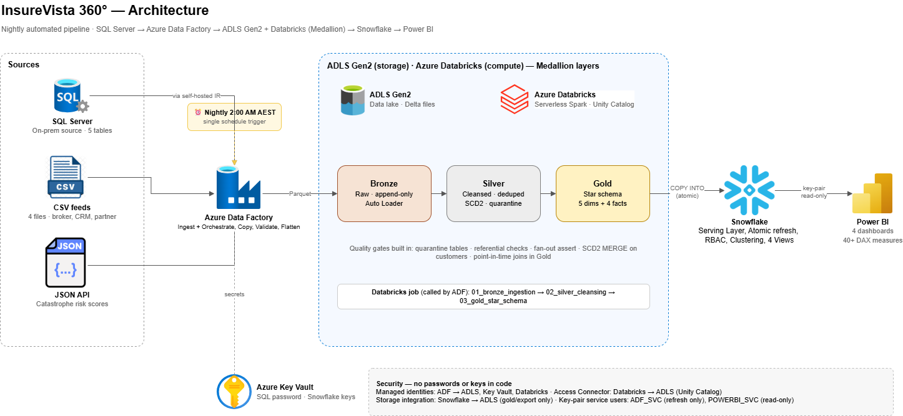
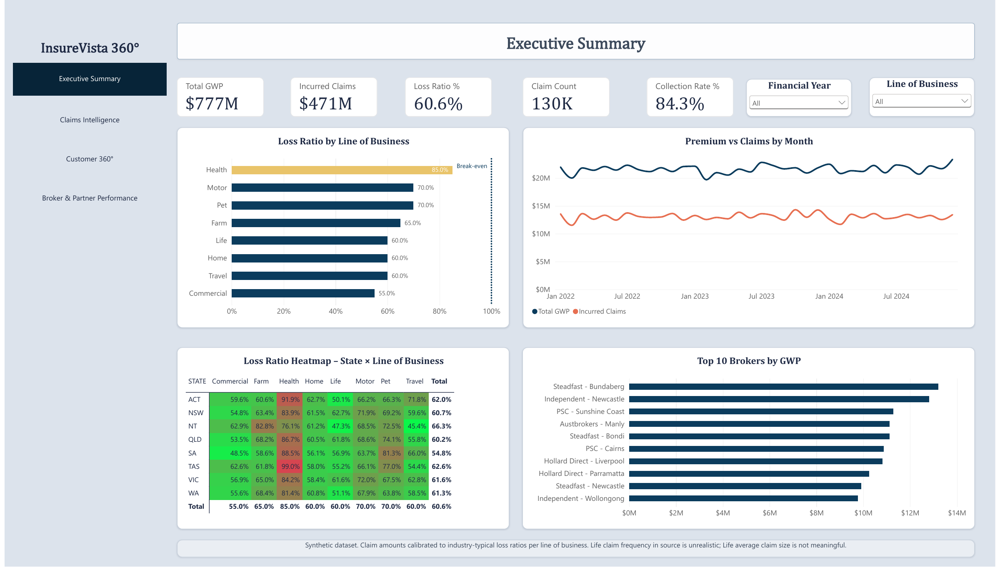
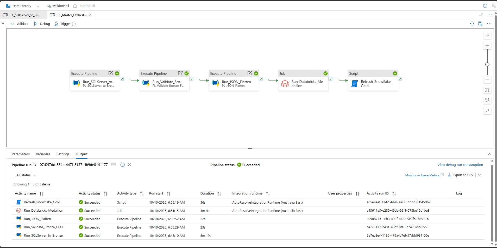

# InsureVista 360° — End-to-End Insurance Data Platform

An automated analytics platform for a simulated Australian general insurer. Every night at 2:00 AM (Sydney time) it moves data from an on-premises SQL Server through an Azure/Databricks Medallion lakehouse into Snowflake, and on to four Power BI dashboards, with no manual steps.

**SQL Server → Azure Data Factory → ADLS Gen2 + Databricks (Bronze / Silver / Gold) → Snowflake → Power BI**



## Highlights

- **513,781 source rows** from 5 SQL Server tables, 4 CSV feeds and 1 JSON API feed, modelled into a 9-table star schema (5 dimensions, 4 facts).
- **Fully orchestrated:** one ADF schedule runs five chained steps. A failure stops the chain, and the Snowflake load rolls back atomically.
- **Reconciled to the cent at every layer:** incurred claims **$470,534,897.33** and premium received **$776,976,280.62** match from SQL Server through to Power BI.
- **No secrets in code:** Azure services use managed identities, SQL credentials live in Key Vault, and Snowflake service users authenticate with RSA key pairs.
- **Least privilege proven by deliberate failure:** the analyst role cannot `TRUNCATE`; the loader role can refresh every table through a stored procedure but cannot `SELECT` any of them.
- **Nine defects caught by reconciliation,** including a fan-out join in the original design that overstated claims 4×.



## Tech stack

| Layer | Tool | What it does |
|---|---|---|
| Source | SQL Server (on-premises) | Existing policy system: Customers, Brokers, Policies, Claims, Premium_Transactions |
| Ingest | Azure Data Factory + self-hosted IR | Parameterised ForEach copy to Parquet, file-feed validation, JSON → Parquet |
| Bronze | Databricks Auto Loader | Append-only Delta tables with audit columns; checkpointed, so a re-run loads +0 rows |
| Silver | Databricks (PySpark) | Dedup, typing, normalisation, referential integrity, quarantine tables, **SCD Type 2** on customers via `MERGE` |
| Gold | Databricks (PySpark) | Star schema with `xxhash64` surrogate keys, Unknown (-1) members, point-in-time customer joins |
| Serve | Snowflake | Storage integration, atomic refresh procedure, clustered facts, RBAC, semantic views, resource monitor |
| Present | Power BI | Star-schema model, 41 DAX measures, 4 dashboards, key-pair service user (read-only) |
| Govern | Unity Catalog, Azure Key Vault | Lineage across layers, external locations, secret storage |

## Pipeline

`PL_Master_Orchestrator` runs nightly and chains:

1. **SQL Server → Bronze:** copies 5 tables to date-partitioned Parquet (retries 2 × 60 s).
2. **Validate file feeds:** Get Metadata and If Condition checks; fails fast if a feed is missing.
3. **JSON → Parquet:** flattens the catastrophe risk API feed.
4. **Databricks job:** Bronze → Silver → Gold notebooks.
5. **Snowflake refresh:** calls `SP_REFRESH_GOLD`, which deletes and reloads all 9 tables in one transaction and rolls back on any error.



## Key design decisions

| Decision | Why |
|---|---|
| Auto Loader (append) instead of overwrite in Bronze | Keeps every daily snapshot replayable; re-runs are idempotent |
| Dedup by the snapshot date in the file path | Two loads shared one ingestion timestamp, so ordering by timestamp picked rows at random |
| Hash surrogate keys (`xxhash64`) | Stable across rebuilds, unlike row-number keys |
| Unknown (-1) member in every dimension | Inner joins would silently drop facts with missing keys |
| Separate plain-Parquet export for Snowflake | `COPY INTO` over a Delta folder would load superseded file versions |
| Snowflake storage integration instead of a SAS token | No secret in SQL, no expiry |
| Owner's-rights stored procedure for the load | The loader can refresh tables without being able to read them |
| Power BI Import mode | ~350k fact rows fit in memory; no warehouse wake-up on every click |

## Bugs found and fixed (selected)

| Symptom | Root cause | Fix |
|---|---|---|
| Design-doc views reported claims of $16.69B against $4.15B true (pre-calibration) | Fact-to-fact join through a shared dimension (chasm trap) | Aggregate each fact separately, then join |
| Historical claims vanished from views | View filtered `is_current = 1`, but point-in-time keys point at historical versions | Removed the filter |
| Customer lifetime value overstated | `SUM()` over an SCD2 dimension counted every version | Measure filtered to current rows |
| Every NatCat bar showed the same value | `CALCULATE` filter replaced the visual's own filter | `KEEPFILTERS()` |
| Read-only role test passed when it should have failed | Snowflake secondary roles authorised in the background | `USE SECONDARY ROLES NONE`; service users hold one role |
| Bronze returned 2× rows | Recursive read over two date folders | Auto Loader checkpoints + Silver dedup |

## Data findings

Profiling showed the synthetic source was structurally clean (zero null keys, zero orphan foreign keys) but statistically unrealistic. Claims were **534% of premium**, against roughly 55–75% for Australian general insurers. Claim amounts were calibrated per line of business in a clearly separated, transactional, backed-up step (`sql_server/test_data_setup/`), giving a **60.6%** overall loss ratio. Remaining limits of the synthetic data (Life claim frequency, uniform distributions, retention proxy) are disclosed in the write-up and footnoted on each dashboard.

## Repository structure

```
├── adf/                     ARM template: pipelines, datasets, linked services, trigger
├── databricks/
│   ├── notebooks/           01_bronze_ingestion · 02_silver_cleansing · 03_gold_star_schema
│   ├── profiling/           source profiling queries
│   └── job_definition.json  Bronze → Silver → Gold job
├── snowflake/               01–06: integration, gold load, RBAC + clustering, views, service user, refresh procedure
├── sql_server/
│   ├── source_profiling/    read-only checks against the existing source
│   └── test_data_setup/     NOT part of the pipeline: SCD2 test changes, synthetic data calibration
├── powerbi/                 DAX measures, theme, dashboard PDF
└── docs/                    architecture diagram, screenshots, full write-up
```

## Limitations and production next steps

| Limitation | Production fix |
|---|---|
| SQL Server runs on a laptop, so the 2:00 AM run needs it awake | Server-hosted or Azure SQL source |
| A changed same-day file would be skipped by Auto Loader | Timestamp in file names, or `cloudFiles.allowOverwrites` |
| Power BI Desktop only; refresh is manual | Publish to the Power BI Service with a scheduled refresh |
| No pushed failure alerts | Azure Monitor alert on failed master-pipeline runs |

## More detail

- [Full project write-up (PDF)](docs/InsureVista_360_writeup.pdf): architecture, all 10 design decisions, all 9 bugs, security model, reconciliation
- [Dashboards (PDF)](powerbi/InsureVista_360_dashboards.pdf)
- [Screenshots](docs/screenshots/)

---

*Portfolio project by Tshering Gyeltshen. All data is synthetic. "Hollard" names in schemas refer to the simulated scenario; this project is not affiliated with any insurer.*
